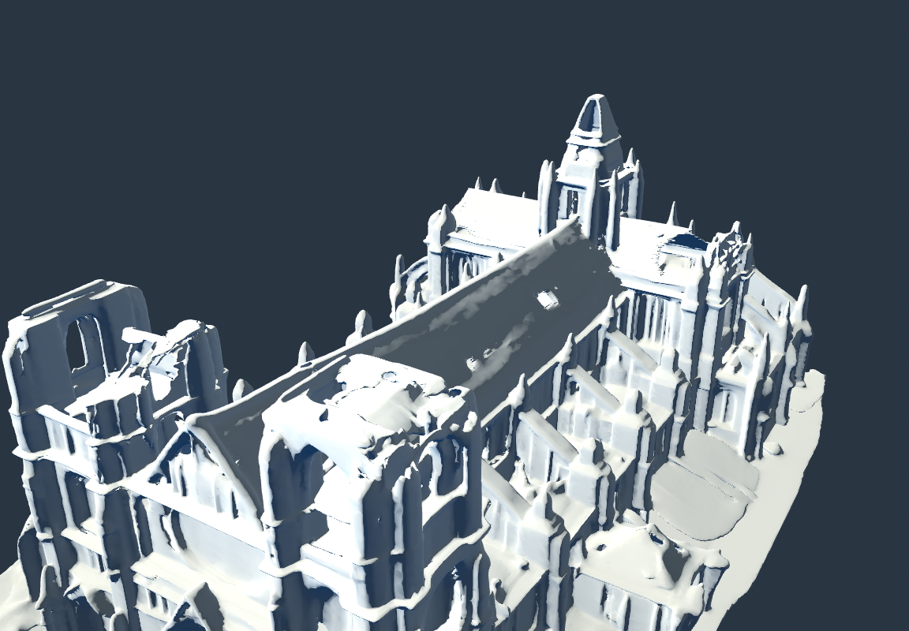
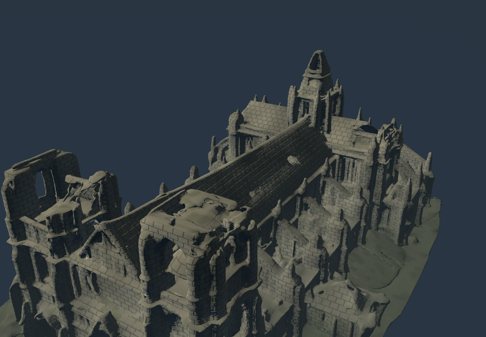
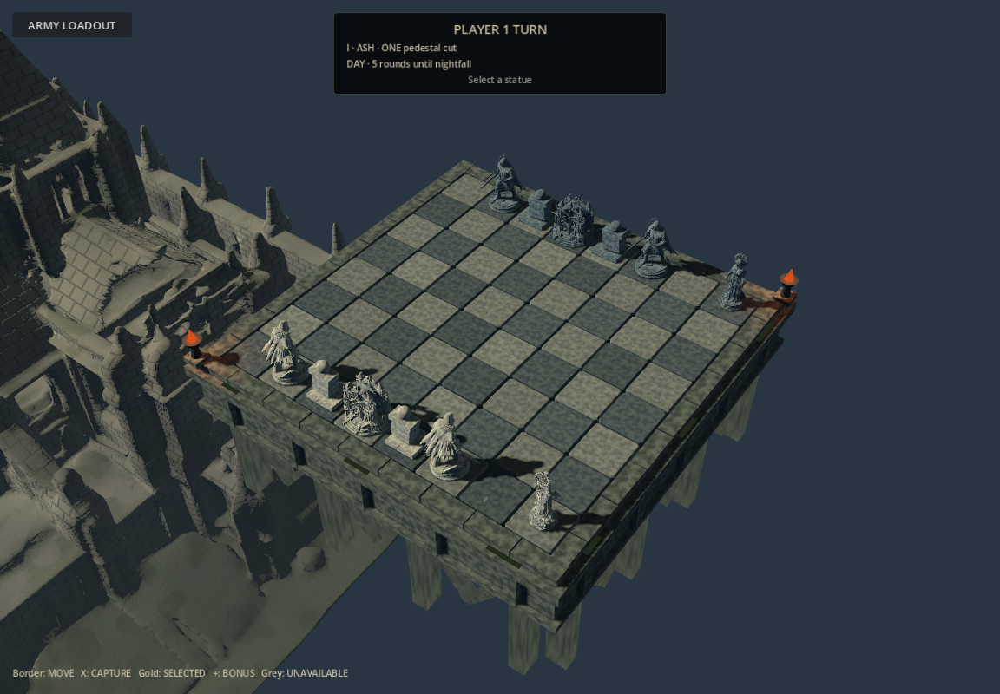

# Cathedral visual pass

Based exclusively on the user's `19eef09` (New statues + cathedral). The local,
unpublished Warden replacement branch was not merged. Statue models, character
scenes, formation and gameplay scripts remain unchanged.

The original cathedral GLB is retained byte-for-byte at its original path.
`assets/world/cathedral/cathedral_stone.glb` is a derivative made in Blender 4.3.2:
roughly 161k triangles instead of 503k, plus ten small fallen foundation stones.
Godot import also generates LODs. `scripts/art/prepare_cathedral.py` reproduces it.
No added physics, lights, animations, external assets or purchases.

A presentation-only script assigns the masonry shader to the derivative.
The shader uses local spatial coordinates (the source has no UVs), mortar relief,
stone grain, matte roughness, darker damp foundation and restrained moss on
upward-facing ledges. Joint filtering uses screen derivatives to reduce aliasing.
These are original procedural materials, not photographic texture scans.

The height-fog density is reduced from 0.2 to 0.025, with explicit distance density
0.0027: the original fog hid virtually the entire cathedral. Existing day/night
lights and their timings are preserved. The unsupported FogVolume was removed
from the Compatibility scene; native environment fog remains.

## Comparison

Original and derivative below use identical camera and lighting, and the same
corrected fog to make the original geometry visible for a fair surface comparison.
The initial unmodified atmosphere rendered the detail view almost entirely as fog.

| Original mesh/material | Improved mesh/material |
| --- | --- |
|  |  |

## Source and limitations

The source is the user's existing file; glTF metadata identifies its generator as
Tripo. No new third-party asset was downloaded and no additional license is claimed
for the supplied model. Existing source ownership/terms remain applicable.

The shape is preserved, including its existing irregular/soft AI-generated details.
This pass improves material, cost and visibility; it is not a complete architectural
remodel or a claim of photorealism. The masonry pattern is procedural and approximate
around curved ornaments. Windows/arches were not rebuilt.

Cloud verification uses Godot 4.6.3 with software OpenGL Compatibility; the project
retains its 4.7 metadata. The supplied Warden `.blend` cannot be read by cloud Blender
4.3.2 (incomplete/newer-format header). That import problem also exists with the
untouched user revision. Statue source files were not changed to work around it.
Consequently complete roster validation in this environment remains limited.

On Windows: close Godot, Pull origin in GitHub Desktop, reopen and let import finish.
F5, confirm armies, start match. Inspect the cathedral beside the board, both day
and night; test selecting edge squares and an ordinary capture with camera return.

## Executed checks

- Cathedral scene/picking: 65 assertions passed, including unchanged ray results
  at all 64 board centers with the cathedral shown/hidden and no scenery colliders.
- Two capture regression scenarios: 125 assertions passed headlessly. Rendered:
  123 passed, two duration limits failed (Hunter 3.15 s, Witch 3.40 s) on software
  OpenGL. The unsupported Warden source limits conclusions about its visual capture.
- Actual day/night and detail images rendered and inspected. No cathedral shader
  compilation error. Original cathedral and all character sources/scenes unchanged.
- Derived building: 160,842 triangles plus 200 debris triangles; original 502,634.
  No new textures or external dependencies. Blender export is uncompressed GLB.
- Compatibility cannot render FogVolume; that existing node is removed in this pass.
  Corrected native distance/height fog supplies the atmosphere instead.
